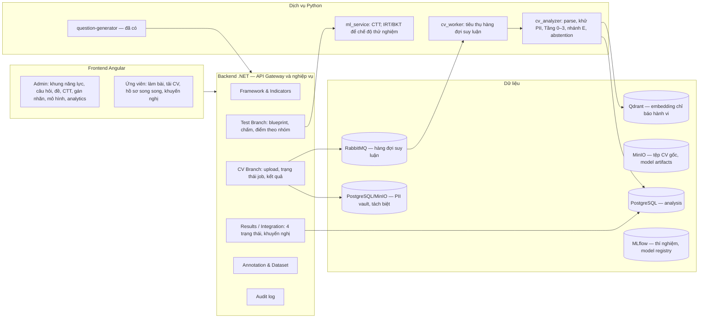
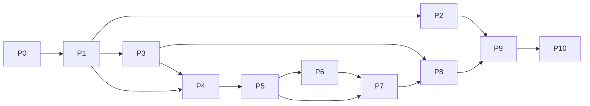

# Roadmap hoàn thiện hệ thống AI-CAS theo luận văn

> **Căn cứ:** Luận văn *"Nghiên cứu phương pháp học máy trong đánh giá năng lực sử dụng AI"* (bản v8.1 – CV + Test song song) và kết quả review mã nguồn tại commit `fb5b2bd`.
>
> **Mục đích:** Xác định khoảng cách giữa hệ thống hiện tại và thiết kế trong luận văn, sau đó chia phần còn thiếu thành các phase có thứ tự, sản phẩm bàn giao và tiêu chí hoàn thành rõ ràng.
>
> **Ngày lập:** 2026-10-11

---

## Mục lục

1. [Định hướng của luận văn](#1-định-hướng-của-luận-văn)
2. [Hiện trạng mã nguồn](#2-hiện-trạng-mã-nguồn)
3. [Lỗi và nợ kỹ thuật cần xử lý trước](#3-lỗi-và-nợ-kỹ-thuật-cần-xử-lý-trước)
4. [Kiến trúc mục tiêu](#4-kiến-trúc-mục-tiêu)
5. [Tổng quan các phase](#5-tổng-quan-các-phase)
6. [Chi tiết từng phase](#6-chi-tiết-từng-phase)
7. [Ma trận truy vết luận văn → phase](#7-ma-trận-truy-vết-luận-văn--phase)
8. [Rủi ro và quyết định cần chốt](#8-rủi-ro-và-quyết-định-cần-chốt)

---

## 1. Định hướng của luận văn

Bản v8.1 của luận văn **đổi trọng tâm** so với những gì mã nguồn hiện đang triển khai:

| Khía cạnh | Mã nguồn hiện tại | Luận văn v8.1 |
|---|---|---|
| Trọng tâm học máy | IRT 3PL, CAT, BKT trên phản hồi trắc nghiệm | **Phân tích CV** bằng NLP/ML (Tầng 0–3 và nhánh bằng chứng E) |
| Nhánh trắc nghiệm | Bài test thích ứng, ước lượng θ | Bài test rút gọn 35–42 câu (5–6 câu/nhóm), phân tích bằng **CTT** |
| Hồ sơ năng lực | Điểm 0–100 theo domain, tính từ θ và BKT | **Hai hồ sơ 7 chiều song song** (CV và trắc nghiệm) + tầng tích hợp 4 trạng thái |
| Thang mức | Foundation / Apply / Create (theo θ) | 4 mức có thứ tự: **0 – Không đủ bằng chứng**, Basic, Intermediate, Advanced |
| Giải thích | Không có | Span bằng chứng, chỉ báo còn thiếu, khuyến nghị |
| IRT/MIRT/CAT | Thành phần chính | **Ngoài phạm vi chính**, chỉ là hướng phát triển (§Kết luận) |

Những điểm luận văn yêu cầu:

- **Nhánh CV (§2.1–2.11):** nhận PDF/DOCX → khử PII → trích xuất và phân đoạn → dự đoán vector y = (y₁…y₇), yₖ ∈ {0,1,2,3} → tập span bằng chứng E → danh sách chỉ báo còn thiếu → hiệu chỉnh xác suất và từ chối kết luận (abstention).
- **Nhánh trắc nghiệm (§2.12):** câu hỏi theo 7 nhóm, chấm điểm, CTT (độ khó p, tương quan biến–tổng hiệu chỉnh, phân tích phương án nhiễu, Cronbach α, McDonald ω), chuẩn hóa điểm theo nhóm thành mức B/I/A.
- **Tầng tích hợp (§2.12, §2.15):** so sánh từng nhóm và ghi 4 trạng thái (nhất quán / CV cao hơn / trắc nghiệm cao hơn / CV mức 0 nhưng trắc nghiệm có kết quả); **không** gộp thành một điểm tổng.
- **Vận hành (§2.15):** mỗi dự đoán lưu `model_version`, `dictionary_version`, `preprocessing_version`, `timestamp`, `confidence`; có hàng đợi suy luận, timeout và fallback Tầng 2/3 → Tầng 1 → Tầng 0; CV gốc chứa PII lưu tách khỏi dữ liệu phân tích.
- **Đánh giá (§2.13, Chương 3):** macro-F1, QWK, MAE, exact match, Hamming loss, P/R mức 0, đường coverage–accuracy, F1 span, bootstrap CI, fairness, độ bền, SUS.

---

## 2. Hiện trạng mã nguồn

### 2.1. Các thành phần đã có

| Khu vực | Thành phần | Vị trí |
|---|---|---|
| Backend .NET 8 | OpenIddict (password + PKCE), Identity, EF Core/PostgreSQL | `backend/AiCompetency.Api/Program.cs`, `Controllers/AuthorizationController.cs` |
| | CRUD câu hỏi, lưu lô câu hỏi sinh tự động | `Controllers/QuestionsController.cs` |
| | Làm bài chuẩn (start / submit / result / history), chấm MCQ đơn và đa lựa chọn | `Controllers/CandidateTestsController.cs` |
| | Bài test thích ứng (CAT) và hồ sơ năng lực dựa trên IRT/BKT | `Controllers/AdaptiveTestsController.cs`, `Services/CompetencyProfileService.cs` |
| Sinh câu hỏi (Python) | Pipeline agentic: RAG, web search, generator, verifier, judge, align theo 7 nhóm | `src/question-generator/` (**điểm mạnh, giữ lại**) |
| ML service (Python) | FastAPI: IRT (MLE/EAP, calibrate, Fisher), BKT, profile; có unit test | `src/ml_service/` |
| Frontend Angular 17 | Admin: câu hỏi, AI generator, tests, rubrics, results | `frontend/ai-competency-ui/src/app/features/admin/` |
| | Ứng viên: home, test runner, adaptive runner, kết quả, hồ sơ radar | `frontend/ai-competency-ui/src/app/features/candidate/` |
| Hạ tầng | Postgres, Mongo, RabbitMQ, MinIO, Qdrant, question-generator | `infra/docker-compose.yml` |

### 2.2. Đối chiếu với luận văn

Chú thích: ✅ đã có · 🟡 có một phần hoặc lệch thiết kế · ❌ chưa có

| Yêu cầu luận văn | Mục | Trạng thái | Nhận xét |
|---|---|---|---|
| Khung 7 nhóm × 3 mức + chỉ báo hành vi | §1.2, PL-A | 🟡 | Có trong `framework_mapping.yaml` và `data/contexts/`. Bảng `frameworks/domains/skills/criteria` chỉ nằm trong `db/schema.sql`, không có trong EF. Chưa có hệ chỉ báo hành vi có cấu trúc và phiên bản |
| Lược đồ nhãn 4 mức (có mức 0) | §1.2.1, §2.3 | ❌ | Chưa có khái niệm "Không đủ bằng chứng" |
| Rubric gán nhãn CV, sổ tay gán nhãn | §2.3, PL-B | ❌ | Màn Rubrics hiện là mock và dành cho chấm câu tự luận |
| Ngân hàng câu hỏi theo 7 nhóm | §2.12 | ✅ | Sinh tự động tốt. Thiếu quy trình rà soát chuyên gia (Reviewed) và liên kết có cấu trúc tới nhóm/mức |
| Blueprint đề 35–42 câu, 5–6 câu/nhóm | §2.12 | 🟡 | `TestsController` chỉ lưu metadata, không gắn câu hỏi. `start-standard` lấy ngẫu nhiên 50 câu, không phân tầng theo nhóm |
| Chấm điểm và điểm theo nhóm | §2.12 | 🟡 | Chỉ có tổng điểm. Câu `scenario` được đánh dấu "manual review" nhưng chưa có luồng chấm |
| Phân tích CTT | §2.12, PL-H | ❌ | — |
| Tiếp nhận CV PDF/DOCX, OCR, phân đoạn | §1.4.1, §2.5 | ❌ | — |
| Khử định danh (PII), đồng thuận, nhật ký xử lý | §2.4.3 | ❌ | — |
| Gán nhãn kép, span, phân xử, IAA (QWK, Krippendorff α) | §2.4.2 | ❌ | — |
| Chia tập chống rò rỉ, test khóa kín | §2.4.4 | ❌ | — |
| Tầng 0: từ điển và luật | §2.6, PL-D | ❌ | — |
| Tầng 1: TF-IDF + LR/SVM/XGBoost, mã hóa tích lũy | §2.7 | ❌ | — |
| Tầng 2: PhoBERT/XLM-R với 7 đầu ra thứ bậc | §2.8 | ❌ | — |
| Tầng 3: LLM zero/few-shot đầu ra JSON | §2.9, PL-E | 🟡 | Đã có hạ tầng gọi LLM (`openai_helper.py`), dùng lại được |
| Nhánh E: span và đối sánh ngữ nghĩa với chỉ báo | §2.10 | ❌ | Qdrant đã có trong compose nhưng chưa dùng |
| Tổng hợp, hiệu chỉnh, abstention | §2.11 | ❌ | — |
| Tầng tích hợp 4 trạng thái + khuyến nghị | §2.12 | ❌ | — |
| Hồ sơ 7 chiều | §2.15 | 🟡 | Có radar nhưng tính từ θ/BKT. Hồ sơ thực tế **không được sinh** vì `skill_id` không bao giờ được gán |
| Audit phiên bản mô hình, hàng đợi, fallback | §2.15 | ❌ | RabbitMQ có trong compose nhưng chưa dùng |
| Fairness, độ bền, giải thích, SUS | §2.13, §3.10–3.11 | ❌ | — |
| Báo cáo và analytics cho admin | §3.9 | 🟡 | `report.service.ts` và `rubric.service.ts` là mock; dashboard rỗng; `irt-analysis` chưa có route |
| IRT / CAT / BKT | (ngoài phạm vi) | ✅ có nhưng lỗi | Nên chuyển sang chế độ thử nghiệm (xem Phase 2) |

---

## 3. Lỗi và nợ kỹ thuật cần xử lý trước

Những lỗi dưới đây ảnh hưởng trực tiếp đến tính đúng của dữ liệu thực nghiệm, nên được xử lý ở **Phase 0**.

| # | Mức độ | Vấn đề | Vị trí |
|---|---|---|---|
| B1 | 🔴 Nghiêm trọng | `GetCurrentUserId()` parse `NameIdentifier` thành `int`, nhưng Identity dùng ID kiểu chuỗi GUID nên **mọi người dùng đều bị quy về `user_id = 1`**. Dữ liệu bài làm và hồ sơ của các ứng viên bị trộn vào nhau | `CandidateTestsController.cs:39`, `AdaptiveTestsController.cs:44`, `CompetencyProfileController.cs:31` |
| B2 | 🔴 | CAT coi mọi câu trả lời không rỗng là **đúng** (`isCorrect = !IsNullOrWhiteSpace`) | `AdaptiveTestsController.cs:176` |
| B3 | 🔴 | `SubmitAnswer` không `Include(Responses)`, nên EAP chỉ dùng câu hiện tại thay vì toàn bộ lịch sử | `AdaptiveTestsController.cs:165` |
| B4 | 🔴 | `Task.Run` chạy pipeline ML sau khi response đã trả về, nhưng dùng `DbContext` scoped và `HttpContext.User`. Dễ gặp `ObjectDisposedException`, và lỗi bị nuốt bởi `catch {}` | `CandidateTestsController.cs:265-290` |
| B5 | 🔴 | `Question.SkillId` không bao giờ được gán (khi tạo hoặc lưu lô), và bảng `skills/domains` không có trong EF. Vì vậy BKT và profile **không bao giờ chạy**; câu SQL thô trong `CompetencyProfileService` sẽ lỗi nếu chưa chạy tay `schema.sql` | `QuestionsController.cs`, `CompetencyProfileService.cs:189-195` |
| B6 | 🟠 Cao | Dùng `EnsureCreatedAsync()` song song với EF Migrations, nên migration mới không được áp dụng trên DB đã tồn tại | `Program.cs:95` |
| B7 | 🟠 | Không phân quyền: `QuestionsController`, `TestsController`, `QuestionGenerationController` và `/api/seed-difficulty` không có `[Authorize]`; các endpoint `admin/*` không kiểm tra vai trò; chưa có role Admin/Candidate | `Controllers/*.cs`, `Program.cs:192` |
| B8 | 🟠 | `/api/seed-difficulty` gán độ khó ngẫu nhiên 1–10 và tự publish mọi câu, trong khi ánh xạ IRT giả định thang 1–5. `TransformLevel` gộp *mức năng lực* với *độ khó* | `Program.cs:192-214`, `QuestionsController.cs:133,158` |
| B9 | 🟠 | Các minimal API in-memory còn sót lại (`/api/frameworks`, `/api/exams`, `/api/sessions`, `/api/responses`) trả dữ liệu giả | `Program.cs:150-190` |
| B10 | 🟠 | Frontend gọi sai URL: `competency.service.ts` thiếu tiền tố `/api`; `test.service.ts` dùng đường dẫn tương đối `/api/tests` trong khi không cấu hình proxy | `core/competency/competency.service.ts:62`, `core/tests/test.service.ts:10` |
| B11 | 🟡 Trung bình | Kết quả CAT dùng `PassScore = 6` trên thang θ ∈ [-4, 4], nên không ai đạt | `AdaptiveTestsController.cs:256` |
| B12 | 🟡 | Ba bộ mã nhóm/mức không thống nhất: `syllabus.csv` (5 nhóm cũ, `NenTang/ApDung/KienTao`), `framework_mapping.yaml` (7 nhóm, `Basic/Intermediate/Advanced`), frontend (`Foundation/Apply/Create`) | `src/question-generator/data/`, `models/question.model.ts` |
| B13 | 🟡 | `ml_service` chưa có trong `infra/docker-compose.yml` và chưa có Dockerfile | `infra/` |
| B14 | 🟡 | Không có CI. Không có test cho backend và frontend; chỉ `src/ml_service/tests/test_ml.py` có test | — |
| B15 | ⚪ Thấp | Code chết: `admin/admin-portal.component.*`, `candidate/candidate-dashboard.component.*` (số liệu tĩnh); `src/ai_competency_assessment` (POC FLAN-T5); README nhắc tới `docker-compose.yml` ở thư mục gốc nhưng file này không tồn tại | — |
| B16 | ⚪ | `docs/ml-methods.md` mô tả IRT/CAT/BKT là phương pháp chính, mâu thuẫn với luận văn v8.1 | `docs/ml-methods.md` |

---

## 4. Kiến trúc mục tiêu

**Quyết định kiến trúc đề xuất:**

- Tạo **dịch vụ mới `src/cv_analyzer/`**, tách khỏi `ml_service`, vì phụ thuộc nặng (torch, transformers, OCR) và cần GPU/hàng đợi riêng. `ml_service` giữ vai trò thống kê nhẹ: CTT, và IRT/BKT ở chế độ thử nghiệm.
- Tách phần nghiên cứu (huấn luyện, thí nghiệm) và phần suy luận: `src/cv_analyzer/research/` chứa script huấn luyện, đánh giá và notebook; `src/cv_analyzer/app/` là FastAPI để suy luận. Hai phần dùng chung module tiền xử lý để bảo đảm *nhất quán huấn luyện ↔ suy luận* (§1.4.2).
- **PII vault**: tệp CV gốc lưu ở bucket MinIO riêng, và bảng ánh xạ danh tính nằm trong schema/DB riêng có quyền truy cập hạn chế. Mọi bảng phân tích chỉ dùng `pseudo_id` (§2.4.3).
- Dùng **MLflow** (file store cục bộ) để lưu seed, siêu tham số, checkpoint và metric, phục vụ tái lập (§2.8, §3.1, PL-F).

---

## 5. Tổng quan các phase

| Phase | Tên | Phụ thuộc | Ước lượng* | RQ |
|---|---|---|---|---|
| **P0** | Ổn định nền tảng và sửa lỗi chặn | — | 2 tuần | — |
| **P1** | Khung năng lực, lược đồ nhãn 4 mức, taxonomy thống nhất | P0 | 2 tuần | RQ1 |
| **P2** | Nhánh trắc nghiệm song song và phân tích CTT | P1 | 3 tuần | RQ4 |
| **P3** | Tiếp nhận CV, tiền xử lý và khử định danh | P1 | 3 tuần | RQ5 |
| **P4** | Gán nhãn kép, span bằng chứng và bộ dữ liệu CV | P1, P3 | 3 tuần phát triển, 8–12 tuần lịch thu thập | RQ1 |
| **P5** | Khung đánh giá, Tầng 0 và Tầng 1 | P4 (N ≥ 50 để chạy thử) | 3 tuần | RQ2 |
| **P6** | Tầng 2 (Transformer) và Tầng 3 (LLM) | P5 | 4 tuần | RQ2 |
| **P7** | Nhánh bằng chứng E, tổng hợp, hiệu chỉnh và abstention | P5, P6 | 4 tuần | RQ3 |
| **P8** | CV Analyzer trong hệ thống (serving và UI) | P3, P7 | 3 tuần | RQ5 |
| **P9** | Tầng tích hợp CV × trắc nghiệm và khuyến nghị | P2, P8 | 2 tuần | RQ4 |
| **P10** | Fairness, độ bền, khả dụng và đóng gói kết quả luận văn | P9 | 3 tuần | RQ2–RQ5 |

\* Ước lượng cho 1 người làm toàn thời gian. Thời gian lịch của P4 phụ thuộc người gán nhãn và tiến độ thu thập CV.

> ⚠️ **Đường găng là dữ liệu (P4).** Việc xin phiếu đồng thuận, thu thập 200–300 CV nguồn A và gán nhãn kép tốn nhiều thời gian lịch nhất. Nên **bắt đầu thủ tục thu thập và đồng thuận ngay trong P0/P1**, chạy song song với phát triển, và dùng cổng cỡ mẫu (§2.14) để quyết định mức độ kết luận ở P5–P6.

---

## 6. Chi tiết từng phase

### Phase 0 — Ổn định nền tảng và sửa lỗi chặn

**Mục tiêu:** Có nền tảng đúng và tái lập được để mọi dữ liệu thu thập về sau đều hợp lệ.

**Công việc**

- [ ] **Định danh người dùng (B1):** chuyển mọi cột `user_id` sang `string` (Identity GUID) hoặc thêm `pseudo_id`; viết helper `ICurrentUser` đọc claim `sub`; bỏ fallback `return 1`.
- [ ] **Vai trò:** seed role `Admin`, `Annotator`, `Candidate`; thêm claim role vào token; dùng `[Authorize(Roles=...)]` cho admin API, câu hỏi, đề và sinh câu hỏi (B7); thêm `roleGuard` ở frontend.
- [ ] **Đăng ký ứng viên:** endpoint `POST /api/account/register` và màn đăng ký. Đây là điều kiện để thu thập dữ liệu thật.
- [ ] **Migrations (B6):** thay `EnsureCreatedAsync` bằng `Database.MigrateAsync()`; đưa `frameworks/domains/skills/criteria` vào EF (sẽ làm lại ở P1); để `db/schema.sql` được sinh tự động bằng `dotnet ef migrations script`.
- [ ] **Xử lý nền (B4):** thay `Task.Run` bằng `BackgroundService` + `Channel<T>` (hoặc RabbitMQ consumer) có scope DI riêng; ghi log lỗi thay vì nuốt.
- [ ] **Dọn API giả (B9) và seed nguy hiểm (B8):** xóa minimal API in-memory; bỏ `/api/seed-difficulty` (hoặc chỉ bật ở môi trường Development); tách rõ `difficulty` và `competency level`.
- [ ] **Sửa CAT (B2, B3, B11)** nếu giữ lại: chấm bằng `EvaluateAnswer` dùng chung; nạp đủ lịch sử phản hồi; bỏ `PassScore = 6`.
- [ ] **Frontend (B10):** gom base URL vào `environment.apiUrl + '/api'`; dựa vào `authInterceptor` đã đăng ký sẵn, bỏ việc tự đặt header ở từng component; thêm `proxy.conf.json` cho `ng serve`.
- [ ] **Hạ tầng (B13):** thêm Dockerfile và service `ml-service` vào `infra/docker-compose.yml`; tạo `.env.example`; viết `Makefile` hoặc script `dev-up`.
- [ ] **CI (B14):** GitHub Actions gồm `dotnet build/test`, `ng build/test`, `pytest` cho `ml_service` và `question-generator`, `ruff`/`eslint`.
- [ ] **Test tối thiểu:** dự án `AiCompetency.Api.Tests` (xUnit + Testcontainers Postgres) cho chấm điểm và phân quyền; spec Angular cho 1 service và 1 form.
- [ ] **Dọn code chết (B15)** và đánh dấu `docs/ml-methods.md` là "extension, không thuộc phạm vi chính" (B16).

**Sản phẩm bàn giao:** stack chạy bằng một lệnh; CI xanh; nhiều ứng viên dùng song song mà dữ liệu không trộn lẫn.

**Tiêu chí hoàn thành:** hai tài khoản ứng viên làm bài độc lập và lịch sử tách biệt (có test tự động); endpoint admin trả 403 với ứng viên; `docker compose up` dựng đủ dịch vụ.

---

### Phase 1 — Khung năng lực, lược đồ nhãn 4 mức và taxonomy thống nhất

**Liên hệ luận văn:** §1.2, §1.2.1, §2.3, Phụ lục A, B, D.

**Mục tiêu:** Có một nguồn sự thật duy nhất (single source of truth) cho 7 nhóm × 3 mức, chỉ báo hành vi và thang 4 mức, có quản lý phiên bản, dùng chung cho cả nhánh CV và nhánh trắc nghiệm.

**Công việc**

- [ ] **Mô hình dữ liệu** (EF + migration):
  - `competency_framework_versions (id, version, published_at, is_active)`
  - `competency_groups (code, name_vi, name_en, order)` với 7 mã cố định: `FOUNDATION`, `DATA`, `CRITICAL_THINKING`, `APPLICATION`, `ETHICS`, `TOOLS`, `FUTURE_OF_WORK`
  - `proficiency_levels (code, ordinal)`: `0 = NO_EVIDENCE`, `1 = BASIC`, `2 = INTERMEDIATE`, `3 = ADVANCED`
  - `behavior_indicators (id, group_code, level, text_vi, text_en, framework_version)`
  - `cv_rubric_rules (group_code, level, accepted_evidence, insufficient_evidence, examples)`, tương ứng bảng ở §2.3
- [ ] **Thống nhất mã (B12):** viết script migrate `metadata.group/level` của câu hỏi hiện có sang mã chuẩn và thêm cột `group_code`, `target_level` có cấu trúc cho `questions`; cập nhật `framework_mapping.yaml`, `syllabus.csv` và prompt của question-generator; cập nhật model frontend (`Foundation/Apply/Create` → `Basic/Intermediate/Advanced`).
- [ ] **Hệ chỉ báo hành vi:** soạn 3–6 chỉ báo cho mỗi nhóm × mức (≈ 60–120 chỉ báo); nhập liệu qua file YAML có version và seed vào DB. Dùng làm Phụ lục A.
- [ ] **Rubric gán nhãn CV và sổ tay** (Phụ lục B): quy tắc "mọi nhãn 1–3 phải có ít nhất 1 span", kèm ví dụ biên giới giữa các mức. Lưu ở `docs/annotation-guide.md` và trong DB.
- [ ] **Từ điển công cụ/kỹ năng AI có phiên bản** (Phụ lục D, bản khởi tạo): `data/dictionary/ai_tools_vX.yaml` gồm tên chuẩn, alias, nhóm liên quan và cờ tín hiệu mạnh/yếu.
- [ ] **UI admin "Khung năng lực":** xem và sửa nhóm, chỉ báo, rubric; xuất bản phiên bản mới.
- [ ] **API:** `GET /api/framework/active`, `GET /api/framework/{version}/indicators`.

**Tiêu chí hoàn thành:** mọi câu hỏi đã publish có `group_code` và `target_level` hợp lệ; thay đổi khung tạo phiên bản mới mà không phá dữ liệu cũ; chuyên gia duyệt Phụ lục A và B bản 1.0.

---

### Phase 2 — Nhánh trắc nghiệm song song và phân tích CTT

**Liên hệ luận văn:** §1.3.3, §2.12, §2.13 (dòng "Chất lượng bài trắc nghiệm"), §3.9, Phụ lục H.

**Mục tiêu:** Bài test rút gọn chuẩn hóa theo 7 nhóm, chấm được, có hồ sơ điểm theo nhóm và báo cáo CTT.

**Công việc**

- *Ngân hàng câu hỏi và rà soát*
  - [ ] Thêm trạng thái `Reviewed` vào luồng `Draft → Reviewed → Published → Archived`, kèm người duyệt và ghi chú. Chỉ câu đã duyệt mới được đưa vào đề thực nghiệm.
  - [ ] Báo cáo độ phủ ngân hàng theo nhóm × mức × loại câu; dùng question-generator để bù chỗ thiếu.
- *Blueprint và đề*
  - [ ] Mở rộng `Exam`/`TestsController`: định nghĩa quota theo nhóm (mặc định 5–6 câu/nhóm, tổng 35–42), phân bố mức, chế độ cố định hoặc ngẫu nhiên có seed; thêm API gắn, xóa và sắp xếp câu (`exam_questions`); thêm Update, Clone, Archive.
  - [ ] Test builder UI: chọn quota, xem trước đề, bảng độ phủ.
  - [ ] Thay `start-standard` (50 câu ngẫu nhiên) bằng đề lấy theo blueprint đã publish.
- *Chấm điểm*
  - [ ] Tách `EvaluateAnswer` thành `IScoringService` dùng chung cho test chuẩn và CAT; viết unit test cho từng loại câu.
  - [ ] Câu `scenario`/tự luận: luồng chấm theo rubric (thủ công trong admin, tùy chọn có gợi ý LLM-as-judge từ `judgePromptHints`). Nếu luận văn chỉ dùng câu khách quan cho CTT thì ghi rõ và loại câu tự luận khỏi đề thực nghiệm.
  - [ ] Lưu điểm theo nhóm: bảng `test_group_scores (session_id, group_code, raw, max, pct, level_mapped)`.
- *Chuẩn hóa sang mức*
  - [ ] Quy tắc ánh xạ % đúng theo nhóm → Basic/Intermediate/Advanced được **xác định trước** và lưu thành cấu hình có version (§2.12), ví dụ theo ngưỡng do chuyên gia đặt.
- *CTT* (trong `ml_service/ctt/`)
  - [ ] Độ khó p, tương quan biến–tổng hiệu chỉnh (corrected item-total), phân tích phương án nhiễu, Cronbach α (toàn bài và từng nhóm), McDonald ω (mô hình 1 nhân tố, ví dụ dùng `factor_analyzer`), α-if-item-deleted, gắn cờ câu có r < 0.2 hoặc p ∉ [0.2, 0.9].
  - [ ] Endpoint `POST /ctt/analyze` (đầu vào: ma trận phản hồi) và job backend tổng hợp theo đề.
  - [ ] UI "Item analysis" thay cho `irt-analysis`: bảng câu hỏi, cờ chất lượng, biểu đồ phân bố, xuất CSV.
- *Hồ sơ trắc nghiệm*
  - [ ] Thay `CompetencyProfile` (θ + BKT) bằng `test_profiles` gồm 7 nhóm, điểm % và mức. Cập nhật radar ở `test-results` và `competency-profile`.
- *IRT/CAT/BKT*
  - [ ] Bật/tắt bằng feature flag `Features:AdaptiveTesting` (mặc định tắt); ẩn khỏi UI ứng viên; giữ code và test để làm hướng phát triển (§Kết luận).
- *Dashboard admin*
  - [ ] Thay mock trong `report.service.ts` bằng API thật: tỷ lệ đạt, phân bố điểm, heatmap nhóm.

**Tiêu chí hoàn thành:** tạo được đề 35–42 câu đúng quota; ứng viên nhận hồ sơ 7 nhóm sau khi nộp; báo cáo CTT tái lập được từ DB; có thể điền bảng CTT cho Phụ lục H.

---

### Phase 3 — Tiếp nhận CV, tiền xử lý và khử định danh

**Liên hệ luận văn:** §1.4.1–1.4.2, §2.4.3, §2.5, Phụ lục C.

**Mục tiêu:** Pipeline đầu vào CV an toàn và tất định (deterministic), dùng chung cho thu thập dữ liệu, huấn luyện và suy luận.

**Công việc**

- [ ] **Khung dịch vụ `src/cv_analyzer/`:** FastAPI, Dockerfile, `pyproject`/`requirements`, pytest; package `preprocessing/` dùng chung với `research/`.
- [ ] **Trích xuất văn bản:** PDF (PyMuPDF/pdfplumber, giữ thứ tự đọc theo block/cột); DOCX (python-docx, gồm bảng); **OCR dự phòng** khi PDF không có lớp text (Tesseract `vie+eng` hoặc PaddleOCR/VietOCR); cờ chất lượng (tỷ lệ ký tự lạ, độ dài quá ngắn, bố cục nhiều cột) và **từ chối suy luận tự động** khi chất lượng thấp (§2.5).
- [ ] **Chuẩn hóa:** Unicode NFC, chuẩn hóa dấu tiếng Việt, khoảng trắng, phát hiện ngôn ngữ ở mức đoạn (`fasttext-lid`/`langdetect`), giữ nguyên đoạn song ngữ và tên công cụ (không dịch, không stem).
- [ ] **Phân đoạn section:** nhận diện heading tiếng Việt và tiếng Anh (Tóm tắt/Summary, Học vấn/Education, Kinh nghiệm/Experience, Dự án/Projects, Kỹ năng/Skills, Chứng chỉ/Certifications, Hoạt động…) bằng luật; đánh giá trên 30–50 CV mẫu. Mỗi đoạn lưu `section`, `offset_start/end` để truy vết span.
- [ ] **Khử định danh (PII):**
  - Regex: email, số điện thoại VN và quốc tế, URL/LinkedIn/GitHub, CCCD/CMND, ngày sinh, địa chỉ (từ khóa phường/quận/tỉnh).
  - NER tên người và địa danh (underthesea/VnCoreNLP hoặc PhoBERT-NER), kết hợp heuristic khối header.
  - Loại bỏ ảnh. Tùy chọn: che tên trường/công ty (cấu hình *loại tên cơ sở đào tạo* dùng cho phân tích proxy ở §1.3.4).
  - Thay bằng token `[NAME]`, `[EMAIL]`… và lưu bảng ánh xạ trong **PII vault**.
  - Bộ test PII: tối thiểu 30 CV gán tay; mục tiêu **recall PII ≥ 0.98** cho email/điện thoại/tên.
- [ ] **Lưu trữ:** tệp gốc → bucket MinIO `cv-raw` (PII, hạn chế quyền); văn bản đã khử định danh → bảng `cv_documents (id, pseudo_id, source[A|B|C|D], is_synthetic, preprocessing_version, quality_flags, sections jsonb, created_at)`.
- [ ] **Đồng thuận và đạo đức** (Phụ lục C): bảng `consents` (mục đích, loại dữ liệu, thời hạn lưu, quyền rút lui); bước đồng ý bắt buộc trên UI trước khi tải CV; luồng **rút lui** xóa tệp gốc và dữ liệu phân tích.
- [ ] **Audit log:** ghi mọi thao tác đọc/ghi dữ liệu CV (ai, khi nào, mục đích).
- [ ] **API backend:** `POST /api/cv` (upload, giới hạn kích thước và MIME), `GET /api/cv/{id}/status`; trang upload cho ứng viên (chỉ lưu và tiền xử lý, chưa suy luận).
- [ ] `preprocessing_version` được gắn vào mọi đầu ra.

**Tiêu chí hoàn thành:** tải lên 50 CV mẫu (PDF text, PDF scan, DOCX) và nhận văn bản phân đoạn đã khử PII; recall PII đạt ngưỡng; văn bản chưa khử PII không xuất hiện ngoài vault (có test kiểm chứng).

---

### Phase 4 — Gán nhãn kép, span bằng chứng và bộ dữ liệu CV

**Liên hệ luận văn:** §2.3, §2.4.1–2.4.4, §3.2, §3.3.

**Mục tiêu:** Bộ dữ liệu CV tiếng Việt khử định danh, gán nhãn kép 7 nhóm × 4 mức kèm span, có số liệu độ nhất trí giữa người gán nhãn, và tập test khóa kín.

**Công việc**

- [ ] **Công cụ gán nhãn:** khuyến nghị **tích hợp Label Studio** (tự host, hỗ trợ gán span và nhãn phân loại) bằng template 7 nhóm × 4 mức; viết adapter import/export giữa `cv_documents` và Label Studio. Phương án dự phòng là màn gán nhãn nội bộ (Angular) để highlight span và chọn mức.
- [ ] **Ràng buộc nhãn:** nhãn 1–3 bắt buộc có ít nhất 1 span, nếu không hệ thống chặn hoặc đưa vào hàng phân xử.
- [ ] **Quy trình gán nhãn kép:** phân công 2 người độc lập cho mỗi CV nguồn A; người thứ 3 **phân xử** khi lệch từ 2 mức trở lên hoặc bất đồng giữa 0 và có bằng chứng (§2.4.2). Bảng `annotations` và `adjudications` có `annotator_id`, `guideline_version`.
- [ ] **Chỉ số chất lượng nhãn:** QWK theo từng nhóm, Krippendorff α (ordinal) toàn cấu trúc, mức nhất trí cho quyết định 0 và ≠0, tỷ lệ phân xử, chồng lấn span (F1 token). Xuất tự động **Bảng 3.2**.
- [ ] **Nguồn dữ liệu B, C, D** (§2.4.1): import resume công khai (kiểm tra giấy phép), tin tuyển dụng (để làm từ điển và tiền huấn luyện), sinh **CV tổng hợp bằng LLM** theo kịch bản mức/nhóm. Bắt buộc gắn `is_synthetic` và `source`.
- [ ] **Chia tập chống rò rỉ** (§2.4.4): chia theo `pseudo_id` (mọi phiên bản của cùng một người nằm chung partition); kiểm tra trùng lặp gần đúng bằng MinHash/SimHash và cosine embedding; **test chỉ gồm nguồn A** và được khóa (hash manifest, chỉ mở một lần); dữ liệu B, C, D chỉ đi vào train. Test tự động sẽ fail nếu vi phạm.
- [ ] **Phiên bản dữ liệu:** snapshot JSONL theo version (DVC hoặc artifact MLflow); viết **datasheet** cho bộ dữ liệu.
- [ ] **EDA** (§3.3): độ dài theo token, tỷ lệ có từng section, tỷ lệ song ngữ, tần suất công cụ, chồng lấn từ vựng giữa các lớp, **cảnh báo shortcut** (từ khóa gần như độc quyền một lớp).

**Tiêu chí hoàn thành:** có tối thiểu N ≥ 150 CV nguồn A gán nhãn kép (mục tiêu 200–300); báo cáo IAA đầy đủ; manifest train/val/test được khóa; script kiểm tra rò rỉ chạy trong CI.

---

### Phase 5 — Khung đánh giá, Tầng 0 và Tầng 1

**Liên hệ luận văn:** §1.5.1–1.5.2, §1.6, §2.6, §2.7, §2.13, §2.14, §3.4.

**Mục tiêu:** Có harness đánh giá thống nhất và các đường cơ sở mạnh, minh bạch.

**Công việc**

- [ ] **Harness đánh giá** `research/eval/`, dùng chung cho mọi tầng:
  - Metric: macro-F1 (trung bình 7 nhóm, và theo nhóm/mức), QWK, MAE thứ bậc, exact match, Hamming loss, precision/recall mức 0, tỷ lệ đoán nhầm 0 → ≥ Basic, đường **coverage–accuracy**.
  - **Bootstrap CI** cho mọi metric và cho chênh lệch giữa hai mô hình; repeated stratified k-fold và nested CV theo cổng cỡ mẫu (§2.14).
  - Xuất bảng Markdown/LaTeX đúng định dạng **Bảng 3.4–3.8** và log vào MLflow.
- [ ] **Tầng 0 — từ điển và luật** (§2.6): matcher theo từ điển có version (P1) + regex hành động/kết quả; mỗi hit gắn `section`, câu và cường độ (mạnh/yếu theo section và động từ hành động); luật suy mức có giới hạn (không gán Advanced khi thiếu dấu hiệu trách nhiệm, đánh giá hoặc dẫn dắt).
- [ ] **Tầng 1 — TF-IDF** (§2.7): n-gram từ 1–2 và ký tự 3–5, `min_df/max_df` chọn bằng CV; mô hình Logistic Regression (L2), Linear SVM (kèm calibrated), XGBoost (giới hạn độ sâu, early stopping); so sánh **softmax 4 lớp** với **mã hóa tích lũy 3 ngưỡng** (P(y ≥ 1), P(y ≥ 2), P(y ≥ 3), có ràng buộc đơn điệu); class weight hoặc sample weight.
- [ ] **Giải thích Tầng 1:** n-gram có trọng số cao nhất theo nhóm và SHAP cho một số CV; kiểm tra proxy (tên trường, tên công ty, định dạng).
- [ ] **Tái lập:** cố định seed, lưu cấu hình bằng YAML/Hydra, ghi lại phiên bản thư viện (Bảng 3.1, Phụ lục F).

**Tiêu chí hoàn thành:** một lệnh chạy hết toàn bộ Tầng 0–1 trên manifest đã khóa và sinh **Bảng 3.4**; kết quả ổn định qua ≥ 5 seed.

---

### Phase 6 — Tầng 2 (Transformer) và Tầng 3 (LLM)

**Liên hệ luận văn:** §1.5.3, §1.5.6–1.5.7, §2.8, §2.9, §2.14, §3.5, §3.6, Phụ lục E, F.

**Công việc — Tầng 2**

- [ ] Mô hình `vinai/phobert-base` (ưu tiên) và `xlm-roberta-base` (đối sánh khi CV song ngữ nhiều): encoder chung + **7 đầu ra thứ bậc**, mỗi đầu ra có 3 ngưỡng tích lũy; loss BCE theo ngưỡng hoặc CORAL/CORN (`coral-pytorch`); ràng buộc đơn điệu.
- [ ] Văn bản dài: mã hóa theo section hoặc cửa sổ trượt (PhoBERT giới hạn 256 token), sau đó tổng hợp bằng mean/max pooling hoặc attention pooling; tùy chọn thêm embedding loại section.
- [ ] Mất cân bằng: class weight, focal loss, augmentation có kiểm soát (chỉ trên train), CV tổng hợp gắn cờ.
- [ ] **Áp dụng cổng cỡ mẫu (§2.14):** N < 150 thì chỉ đóng băng encoder và huấn luyện head; 150 ≤ N < 400 thì fine-tune có regularization và repeated k-fold; N ≥ 400 thì so sánh đầy đủ và mở test một lần.
- [ ] Ablation (§3.5): thứ bậc vs danh định; section vs cắt đầu; có/không augmentation hoặc class weight; vẽ learning curve.
- [ ] Attribution: Integrated Gradients (Captum) ở mức token/đoạn; không coi attention là lời giải thích.
- [ ] Ghi lại checkpoint, seed, learning rate, batch size, epoch, tiêu chí early stopping vào MLflow, và tạo **model card** (Phụ lục G).

**Công việc — Tầng 3**

- [ ] Prompt gồm định nghĩa 7 nhóm, rubric 4 mức, quy tắc mức 0 và **JSON schema** (`level`, `rationale_span`, `confidence`, `missing_indicators` cho từng nhóm), dùng structured output nếu provider hỗ trợ. Lưu ở Phụ lục E.
- [ ] Zero-shot và few-shot, trong đó ví dụ few-shot **chỉ lấy từ train**.
- [ ] Chạy lặp k lần với temperature thấp để đo độ ổn định; ghi tỷ lệ JSON hợp lệ, token, chi phí và độ trễ (Bảng 3.6).
- [ ] **Kiểm tra span bịa:** mọi `rationale_span` phải khớp (gần đúng) với văn bản CV; span không khớp bị đánh dấu là hallucination và báo cáo riêng.
- [ ] Guard: chỉ gửi **văn bản đã khử PII**; có test chặn gửi nếu văn bản chưa qua bước khử định danh. Dùng lại `openai_helper.py` (OpenAI API hoặc vLLM tự host).

**Tiêu chí hoàn thành:** sinh được **Bảng 3.5, 3.6**; chênh lệch giữa các tầng có kèm CI; model card cho mô hình tốt nhất của Tầng 2.

---

### Phase 7 — Nhánh bằng chứng E, tổng hợp, hiệu chỉnh và abstention

**Liên hệ luận văn:** §1.5.4–1.5.5, §2.10, §2.11, §3.7, §3.8.

**Công việc — Nhánh E**

- [ ] **Bước 1, trích xuất span:** luật (dùng lại Tầng 0) + **token classifier PhoBERT** (BIO: SKILL/TOOL/METHOD/ACTION/OUTCOME), học từ span người gán nhãn đã đánh dấu (giám sát xa từ từ điển nếu ít dữ liệu).
- [ ] **Bước 2, đối sánh ngữ nghĩa:** nhúng span và chỉ báo hành vi (ứng viên: `bkai-foundation-models/vietnamese-bi-encoder`, `BAAI/bge-m3`, `intfloat/multilingual-e5-base`); lưu embedding chỉ báo trong **Qdrant** theo `framework_version`; xếp hạng lại cặp gần ngưỡng bằng cross-encoder (`BAAI/bge-reranker-v2-m3` hoặc fine-tune trên cặp chuyên gia).
- [ ] **Suy mức từ chỉ báo:** điểm mỗi chỉ báo dựa trên số lượng, độ đa dạng và độ mạnh bằng chứng; mức nhóm là mức cao nhất có đủ chỉ báo được hỗ trợ. Sinh danh sách **chỉ báo còn thiếu**, sắp theo khoảng cách tới mức mục tiêu (§2.1).
- [ ] Đánh giá: precision/recall/F1 span, tỷ lệ kết luận có ít nhất 1 span, macro-F1 suy mức từ nhánh E, tỷ lệ bằng chứng được chuyên gia chấp nhận (**Bảng 3.7**).

**Công việc — Tổng hợp và abstention**

- [ ] Ensemble/stacking **chỉ trên out-of-fold predictions** (§2.11).
- [ ] Hiệu chỉnh xác suất bằng temperature scaling trên validation; báo cáo ECE và reliability diagram.
- [ ] **Abstention 2 điều kiện:** confidence < τ **hoặc** không có span hợp lệ thì trả về mức 0 hoặc trạng thái `NEEDS_REVIEW` ("cần đánh giá bổ sung"), không ép thành Basic. Chọn τ trên validation theo đường coverage–accuracy.
- [ ] Phân tích lỗi (§3.8): CV lệch từ 2 mức trở lên, lỗi 0 → Intermediate/Advanced, lỗi shortcut từ khóa (CV chỉ liệt kê công cụ).
- [ ] Sinh **Bảng 3.8** (so sánh tổng hợp các tầng và ensemble, gồm coverage và thời gian/CV).

**Tiêu chí hoàn thành:** cấu hình suy luận cuối cùng được chọn, gồm mô hình + calibrator + τ + phiên bản từ điển, đóng gói thành một **model bundle** có version để đưa vào P8.

---

### Phase 8 — CV Analyzer trong hệ thống (serving và UI)

**Liên hệ luận văn:** §2.15, §3.11, Phụ lục J.

**Công việc — Backend và dịch vụ**

- [ ] `cv_analyzer` nạp model bundle từ MLflow registry hoặc MinIO; endpoint `POST /analyze` trả về: 7 mức, xác suất theo ngưỡng, confidence, cờ abstain, span (offset, section, chỉ báo khớp), chỉ báo còn thiếu.
- [ ] **Hàng đợi suy luận:** backend publish job lên RabbitMQ, `cv_worker` tiêu thụ, kết quả ghi lại và trạng thái được cập nhật (polling hoặc SignalR).
- [ ] **Timeout và fallback:** Tầng 3 hoặc Tầng 2 lỗi/quá thời gian thì chuyển xuống Tầng 1, rồi Tầng 0; ghi `fallback_tier` (§2.15).
- [ ] Bảng `cv_predictions (id, cv_id, model_version, dictionary_version, preprocessing_version, framework_version, timestamp, tier_used, fallback, per_group jsonb, latency_ms, llm_cost)` phục vụ audit.
- [ ] Admin "Model registry": xem các phiên bản, đặt phiên bản active, rollback.

**Công việc — Frontend**

- [ ] Ứng viên: tải CV (sau bước đồng thuận) → theo dõi trạng thái → **hồ sơ 7 chiều**, trong đó mức 0 hiển thị là "Không đủ bằng chứng" chứ không phải điểm thấp.
- [ ] **Trình xem bằng chứng:** highlight span trong văn bản CV đã khử PII; bấm vào một nhóm để xem các span và chỉ báo được hỗ trợ.
- [ ] **Khuyến nghị:** chỉ báo còn thiếu và gợi ý bổ sung CV hoặc học thêm; trạng thái `NEEDS_REVIEW` được hiển thị rõ ràng.
- [ ] Admin: danh sách CV đã phân tích, lọc theo trạng thái, mở chi tiết, có thể gắn nhãn sửa (feedback loop cho active learning sau này).

**Tiêu chí hoàn thành:** chạy được end-to-end từ upload đến hồ sơ có span; tắt dịch vụ Tầng 2/3 thì hệ thống vẫn trả kết quả qua fallback; có số liệu p50/p95 thời gian xử lý.

---

### Phase 9 — Tầng tích hợp CV × trắc nghiệm và khuyến nghị

**Liên hệ luận văn:** §1.3.3, §2.12 (đoạn cuối), §2.15, §3.9.

**Công việc**

- [ ] **Chuẩn hóa thang:** đưa hồ sơ trắc nghiệm (P2) và hồ sơ CV (P8) về cùng thang 0–3 theo từng nhóm, dựa trên quy tắc có version.
- [ ] **Phân loại 4 trạng thái cho mỗi nhóm:**
  1. `CONSISTENT` — nhất quán (|Δ| ≤ ngưỡng)
  2. `CV_HIGHER` — CV thể hiện mạnh hơn trắc nghiệm
  3. `TEST_HIGHER` — trắc nghiệm mạnh hơn CV
  4. `CV_NO_EVIDENCE` — CV mức 0 nhưng trắc nghiệm có kết quả
- [ ] **Bộ luật khuyến nghị:** `TEST_HIGHER` / `CV_NO_EVIDENCE` → đề nghị cập nhật CV với bằng chứng cụ thể; `CV_HIGHER` → đề nghị đánh giá thực hành bổ sung; cả hai thấp → gợi ý học theo chỉ báo còn thiếu.
- [ ] Bảng `integration_reports (user_id, cv_prediction_id, test_session_id, per_group jsonb, rules_version, created_at)`.
- [ ] **UI hiển thị song song:** hai radar chồng lên nhau hoặc hai cột, kèm badge trạng thái theo nhóm; **không có điểm tổng gộp** (§1.3.3, §3.9).
- [ ] **Analytics cấp cohort cho admin:** Spearman/Pearson theo nhóm, % đồng thuận mức, ma trận nhầm lẫn CV × trắc nghiệm, tỷ lệ 4 trạng thái, danh sách ca điển hình để phân tích định tính. Xuất **Bảng 3.9**.

**Tiêu chí hoàn thành:** một ứng viên có cả CV và bài test nhận được báo cáo tích hợp; admin xuất được bảng tương quan và đồng thuận theo nhóm.

---

### Phase 10 — Fairness, độ bền, khả dụng và đóng gói kết quả luận văn

**Liên hệ luận văn:** §1.3.4, §1.6, §2.13, §3.1, §3.10–3.12, Phụ lục F, G, I, J.

**Công việc**

- [ ] **Fairness:** chênh lệch macro-F1/MAE theo nhóm nền (giới tính tự khai, năm tốt nghiệp, trường), chỉ báo cáo khi đủ mẫu; **phân tích proxy** bằng cách so sánh mô hình trên CV đã khử PII với CV đã loại thêm tên cơ sở đào tạo (dùng cấu hình của P3). Thuộc tính nền **không** được dùng làm đặc trưng.
- [ ] **Độ bền:** nhiễu chính tả, bỏ dấu, đổi định dạng hoặc thứ tự section; phương sai qua seed; độ ổn định của LLM.
- [ ] **Giải thích:** chuyên gia chấm mức hợp lý của span và khuyến nghị trên một mẫu ngẫu nhiên.
- [ ] **Khả dụng:** tích hợp bảng hỏi **SUS** (10 câu) và phản hồi định tính vào UI; tính điểm SUS; kiểm thử chức năng theo checklist ở §3.11.
- [ ] **Vận hành:** dashboard p50/p95 latency, tỷ lệ lỗi parsing, tỷ lệ fallback, chi phí LLM.
- [ ] **Đóng gói luận văn:**
  - Script `make thesis-tables` tái tạo mọi bảng "[Cập nhật]" của Chương 3 từ manifest và model đã khóa.
  - Phụ lục F (cấu hình, seed), G (model card, kiểm tra rò rỉ), I (bảng đầy đủ theo nhóm), J (ảnh chụp giao diện).
  - Bảng môi trường 3.1 (phần cứng, OS, phiên bản thư viện, commit/tag).
  - Gắn tag release `thesis-v1.0`.
- [ ] Cập nhật `README.md`, `docs/architecture.md` theo kiến trúc mới; viết lại `docs/ml-methods.md` để mô tả phương pháp CV-ML là chính, còn IRT/BKT thuộc phần mở rộng.

**Tiêu chí hoàn thành:** mọi ô "[Cập nhật]" trong Chương 3 đều có số liệu sinh tự động và tái lập được từ tag release.

---

## 7. Ma trận truy vết luận văn → phase

| Mục luận văn | Nội dung | Phase |
|---|---|---|
| §1.2, PL-A | Khung 7 × 3 và chỉ báo hành vi | P1 |
| §1.2.1, §2.3, PL-B | Lược đồ nhãn 4 mức và rubric gán nhãn CV | P1, P4 |
| §1.3.3, §2.12, PL-H | Bài trắc nghiệm song song và CTT | P2 |
| §1.3.4, §3.10 | Fairness và proxy | P3 (cấu hình che tên trường), P10 |
| §1.4.1–1.4.2, §2.5 | Trích xuất, OCR, chuẩn hóa, phân đoạn | P3 |
| §2.4.1–2.4.2 | Nguồn A–D, gán nhãn kép, IAA | P4 |
| §2.4.3, PL-C | Khử định danh, đồng thuận, nhật ký | P3 |
| §2.4.4, PL-G | Chia tập chống rò rỉ, test khóa kín | P4, P10 |
| §2.6, PL-D | Tầng 0 và từ điển có phiên bản | P1 (khởi tạo), P5 |
| §2.7 | Tầng 1 TF-IDF | P5 |
| §2.8, PL-F | Tầng 2 PhoBERT/XLM-R thứ bậc | P6 |
| §2.9, PL-E | Tầng 3 LLM | P6 |
| §2.10 | Nhánh E: span và đối sánh ngữ nghĩa | P7 |
| §2.11 | Tổng hợp, hiệu chỉnh, abstention | P7 |
| §2.13 | Hệ tiêu chí đánh giá | P5 (harness), P7, P10 |
| §2.14 | Cổng quyết định theo cỡ mẫu | P5, P6 |
| §2.15 | Hệ thống thử nghiệm, audit, hàng đợi, fallback | P0, P8, P9 |
| §3.1–3.12 | Bảng kết quả Chương 3 | P4 → P10 |
| RQ1 | Độ nhất trí gán nhãn | P1, P4 |
| RQ2 | So sánh các tầng mô hình | P5, P6, P7 |
| RQ3 | Đóng góp của nhánh E | P7 |
| RQ4 | So sánh và tích hợp CV × trắc nghiệm | P2, P9 |
| RQ5 | Thiên lệch, giải thích, khả dụng | P8, P10 |

---

## 8. Rủi ro và quyết định cần chốt

### 8.1. Rủi ro chính

| Rủi ro | Ảnh hưởng | Giảm thiểu |
|---|---|---|
| Không đủ CV nguồn A hoặc người gán nhãn | Không đạt N cho fine-tune; kết luận RQ2 yếu | Bắt đầu thu thập sớm; áp dụng cổng cỡ mẫu §2.14; báo cáo ở mức "thăm dò" khi N < 150 |
| Độ nhất trí gán nhãn thấp ở một số nhóm | Trần hiệu năng thấp | Pilot 20 CV trước, hiệu chỉnh rubric rồi mới gán nhãn toàn bộ |
| Lộ PII khi gửi LLM bên ngoài | Vi phạm đạo đức nghiên cứu | Chỉ gửi văn bản đã khử PII (guard có test); ưu tiên LLM tự host (vLLM đã có sẵn trong question-generator) |
| Thiếu GPU cho PhoBERT | Chậm P6 | Dùng encoder đóng băng, Colab/Kaggle, hoặc huấn luyện head nhẹ; với PhoBERT-base cần GPU khoảng 8–16 GB |
| Thuật ngữ và công cụ AI thay đổi nhanh | Từ điển lỗi thời | Từ điển có version; quy trình cập nhật định kỳ |
| Phạm vi lan rộng sang IRT/CAT | Phân tán trọng tâm | Giữ ở feature flag, không đưa vào kết quả chính |

### 8.2. Quyết định cần chốt với giảng viên hướng dẫn

1. **Công cụ gán nhãn:** Label Studio (khuyến nghị, nhanh) hay xây trong hệ thống?
2. **Nhà cung cấp LLM cho Tầng 3:** API thương mại (OpenAI…) hay tự host (gpt-oss qua vLLM)? Quyết định này ảnh hưởng chi phí, độ ổn định và rủi ro dữ liệu.
3. **Mã IRT/CAT/BKT:** giữ sau feature flag (khuyến nghị) hay gỡ khỏi codebase?
4. **Câu hỏi tự luận/tình huống trong đề thực nghiệm:** loại khỏi phân tích CTT hay chấm bằng rubric? Luận văn hiện chỉ mô tả CTT cho câu khách quan.
5. **Quy tắc ánh xạ % đúng → mức B/I/A cho trắc nghiệm** và **ngưỡng Δ cho trạng thái "nhất quán"**: cần chuyên gia xác định trước khi thu dữ liệu.
6. **Lưu trữ PII:** dùng DB riêng hay schema riêng trong cùng Postgres? Thời hạn lưu tệp CV gốc là bao lâu?
